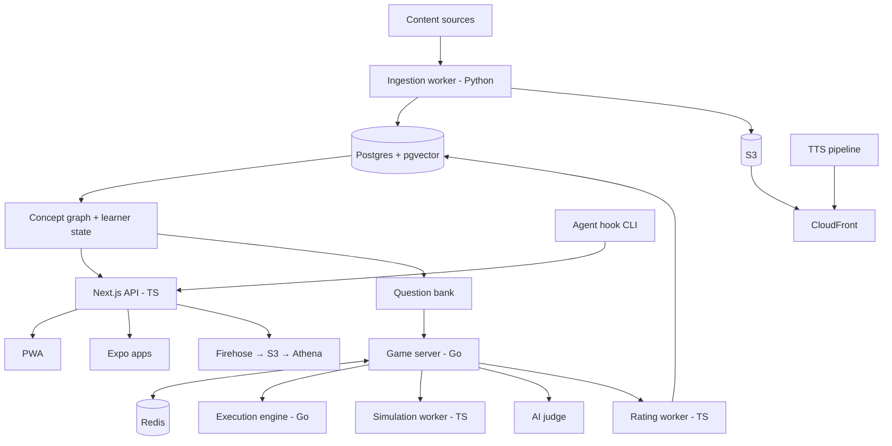

Source: docs/_source/interval-blueprint-2026-10-23.md, Part II, lines 270–546. Copied verbatim below the index, except that export escaping (`\*`, `\[`, `\]`, `` \` ``, `&gt;`, `&lt;`) is unescaped so Markdown and the mermaid diagram render (owner-approved 2026-10-25). No words changed.

## Index

| Category | Decision IDs |
|---|---|
| Architecture | ARCH-1 to ARCH-4 |
| Data | DB-1 to DB-7 |
| Cache | CACHE-1 to CACHE-4 |
| Load handling | LOAD-1 to LOAD-6 |
| Ingestion | ING-1 to ING-6 |
| Persona and learner state | PER-1 to PER-4 |
| Recommendation | REC-1 to REC-5 |
| AI | AI-1 to AI-5 |
| Questions | Q-1 to Q-3 |
| Matching | MATCH-1 to MATCH-7 |
| Bots | BOT-1 to BOT-5 |
| Audio and visual explainers | TTS-1 to TTS-5 |
| HLD | HLDQ-1 to HLDQ-3, CANVAS-1 to CANVAS-6 |
| LLD | LLDQ-1 to LLDQ-4, EXEC-1 to EXEC-5 |
| Security and operations | OPS-1 to OPS-4 |
| AWS mapping | (table, no IDs) |

---

# Part II — Technical architecture and decision log  
  
Context: one engineer, full-time. Stack: TypeScript, Python, and Go. Cloud: AWS managed services. The guiding principle is to use proven technology with few moving parts, and to split out separate services only where a workload behaves differently.  
  
## Architecture  
  
**ARCH-1. A modular monolith, with separate deployables added only when a phase needs them.**  
  
| Phase | Deployables |  
|---|---|  
| 1 | Next.js full-stack app and a Python worker |  
| 3 | Adds the Go game server and Redis |  
| 5 | Adds the code execution engine |  
| 6 | Adds the TypeScript simulation worker |  
  
**ARCH-2. Each language has a strict job.**  
- **TypeScript:** web, mobile, API, shared packages, and the simulation engine.  
- **Python:** ingestion, ML, and AI jobs.  
- **Go:** game servers and the execution engine.  
  
Nothing gets written twice.  
  
**ARCH-3. A monorepo from Phase 4** (pnpm workspaces with Turborepo). Shared packages: types, API client, game protocol client, quiz and scoring logic, design tokens, the diagram component library, and the simulation engine. Next.js and Expo keep separate UI layers.  
  
**ARCH-4. Infrastructure as code with AWS CDK in TypeScript from day one.**  
  

  
## Data  
  
**DB-1. PostgreSQL on RDS is the primary database:** users, content, moments, progress, paths, questions, matches, and ratings.  
  
**DB-2. The concept graph lives in Postgres** as node and edge tables queried with recursive SQL. No graph database is needed at this size.  
  
**DB-3. Embeddings use pgvector,** so vector search can be filtered by rights, source, or difficulty in the same query. Revisit past about 10 million vectors.  
  
**DB-4. Search starts as Postgres full-text search combined with vector search.** OpenSearch or Typesense come later if needed.  
  
**DB-5. Events go through Kinesis Data Firehose into S3 and are queried with Athena.** No Kafka or ClickHouse for now.  
  
**DB-6. S3 stores files:** private encrypted PDFs, audio, scene timelines, replays, and code and design snapshots.  
  
**DB-7. Read replicas and time-partitioned tables** as load grows.  
  
## Cache  
  
**CACHE-1. No Redis in Phase 1.** Precomputed feeds live in a Postgres table.  
  
**CACHE-2. ElastiCache arrives in Phase 3** for matchmaking queues, presence, leaderboards, game events across servers, and the execution queue.  
  
**CACHE-3. Leaderboards use Redis sorted sets,** with Postgres snapshots as the source of truth.  
  
**CACHE-4. CloudFront serves static assets, audio, scene files, replays, and the daily challenge.**  
  
## Load handling  
  
**LOAD-1. Stateless API containers on Fargate** that autoscale.  
  
**LOAD-2. The game server uses the match-actor model.** Each match is owned by one server process, behind an Application Load Balancer with WebSockets, and saves a snapshot after every round.  
  
**LOAD-3. Background work uses SQS; real-time work uses Redis.** Execution queue priorities: ranked, then rooms, then casual, then "Run tests."  
  
**LOAD-4. Known spikes get scheduled scaling.** Battle windows, tournaments, and the daily challenge all have predictable start times.  
  
**LOAD-5. Features degrade gracefully.** A cached feed is the fallback, AI notes are optional, audio is pre-generated, and every submission carries an idempotency key.  
  
**LOAD-6. Rate limits and per-user AI cost budgets.**  
  
## Ingestion  
  
**ING-1. A staged, retryable pipeline:** discover, fetch (respecting robots.txt, per-domain rate limits, and conditional requests), extract while keeping headings, normalize (canonical URLs, near-duplicate detection), classify, segment into moments, store.  
  
**ING-2. Each source's rights profile controls what the pipeline may do:**  
- metadata only  
- excerpt  
- full text for internal processing  
- full text for display (partners)  
  
**ING-3. Polling adapts to each source's publishing rate,** scheduled by EventBridge.  
  
**ING-4. Moments are split at headings into 2 to 8 minute sections,** with deep links and a per-source switch to turn them off.  
  
**ING-5. User PDFs use a private pipeline:** text extraction, Textract OCR for scanned pages, bookmarks, then heading detection.  
  
**ING-6. A curated seed list, quality scores, weekly link checks, and an admin page for reviewing tags and section boundaries.**  
  
## Persona and learner state  
  
**PER-1. Three layers that never overwrite each other:** explicit choices (always win), inferred interests (a time-decayed embedding), and concept mastery.  
  
**PER-2. Mastery is a probability updated by evidence.** Reading counts weakly; quizzes and games count strongly. FSRS schedules reviews.  
  
**PER-3. Cold start:** onboarding choices, GitHub mapping, and an optional placement quiz.  
  
**PER-4. A curated table maps technologies to concepts.** An LLM can suggest additions, which you review.  
  
## Recommendation  
  
**REC-1. Candidate generators:** concept gaps, embedding similarity, followed sources, projects, continue items, due reviews, topic spaces.  
  
**REC-2. Rule-based ranking until there's enough data,** then a gradient-boosted model trained on learning outcomes (completion, saves, later correct answers), not clicks.  
  
**REC-3. Re-ranking** for diversity (MMR plus a per-source cap), time fit, and novelty slots.  
  
**REC-4. Thompson sampling** for exploring adjacent topics and new sources.  
  
**REC-5. Explanations come from the top ranking signal,** using a template polished by a small model, and are cached.  
  
## AI  
  
**AI-1. No full summaries of third-party articles that could replace reading them.** Full explainers are produced only for permitted content and for original concept explainers.  
  
**AI-2. Route by difficulty.** A small, fast model handles tagging, notes, and titles. A stronger model handles explainer scripts, question generation, judging, and coaching. Access is through Amazon Bedrock or Anthropic's API.  
  
**AI-3. Grounded and labeled.** Every output cites its source passages and is stored separately from source text.  
  
**AI-4. Generate once per item, personalize lightly.** Offline jobs use batch processing and prompt caching.  
  
**AI-5. Evaluation sets** for tagging, explanations, and judge agreement run on every prompt or model change.  
  
## Questions  
  
**Q-1. Generator-validator pipeline:** one model drafts a question from a specific moment with a citation; a second model answers it without the key; mismatches are rejected.  
  
**Q-2. Spot checks:** a random 10% sample weekly, plus everything flagged. The daily challenge is reviewed the day before.  
  
**Q-3. Difficulty is recalibrated from real answers** using item response theory. Anomalies are pulled for review.  
  
## Matching  
  
**MATCH-1. Glicko-2 for 1v1, OpenSkill for rooms.** Updates are calculated after the match by a TypeScript worker, not the Go server.  
  
**MATCH-2. One shared quick-game rating at first,** split by mode later.  
  
**MATCH-3. Redis queues with widening bands, grouped by region.**  
  
**MATCH-4. Questions come from the concepts both players share,** at a difficulty matched to their average rating.  
  
**MATCH-5. Server-side timing,** compensated by half the measured network round-trip time, capped at 150 ms.  
  
**MATCH-6. Reconnects, abandons, and rooms:** a 10-second reconnect grace period, abandon penalties, and casual rooms that start with 2 or 3 players after a timeout.  
  
**MATCH-7. Battles use scheduled ranked windows plus an always-open casual queue** with a solo fallback.  
  
## Bots  
  
**BOT-1. Ghosts first:** replays of real recorded runs.  
  
**BOT-2. Synthetic bots second,** built from question difficulty and real players' answer times.  
  
**BOT-3. Always labeled.**  
  
**BOT-4. Half-weight rating changes** against ghosts and bots.  
  
**BOT-5. No bots in ranked battles.** Practice uses a reference timeline instead.  
  
## Audio and visual explainers  
  
**TTS-1. A provider abstraction.** The voice is chosen by a blind test on technical scripts (ElevenLabs versus Inworld), with Polly as a cheap fallback.  
  
**TTS-2. A pronunciation dictionary for technical terms.**  
  
**TTS-3. Word-level timestamps are required,** with forced alignment as the fallback.  
  
**TTS-4. Generate once per concept and stream with HLS through CloudFront.** Personalized intros are short separate clips.  
  
**TTS-5. Visual explainers are scene-timeline JSON rendered as SVG,** not generated video, using the shared diagram library that the HLD canvas also uses.  
  
## HLD  
  
**HLDQ-1. A structured problem format:** requirements, numeric targets, traffic shape, scenarios, rubric, concepts, allowed components, and time limit.  
  
**HLDQ-2. 6 to 8 problem families,** each a template with parameter ranges that generate many variants.  
  
**HLDQ-3. Every variant is validated:** the reference design must pass every scenario, and each design in the family's flawed-design catalog must fail exactly its target scenario. Tournament problems are hand-written and retired.  
  
**CANVAS-1. React Flow,** built on the shared diagram library.  
  
**CANVAS-2. Designs are a versioned JSON graph** with a short justification on each decision, saved automatically.  
  
**CANVAS-3. The analytical simulator models:**  
- request types and routing along graph edges  
- cache hit rates, from cache size versus the working set, with a hot-key skew setting  
- utilization and queueing, giving p50 and p99 estimates  
- storage growth over the problem's horizon  
- node, zone, and region failures, by failover mode  
- availability per scenario  
  
Results are deterministic, come with explanations, and are regression-tested against golden designs.  
  
**CANVAS-4. A public, versioned spec sheet** with season-boundary balance patches.  
  
**CANVAS-5. The same TypeScript engine runs in the browser for preview and on the server as the official scorer.**  
  
**CANVAS-6. The AI judge** scores structured input three times with the median used, hardened against injection, with a calibration set of about 50 designs you grade yourself and an appeals queue.  
  
## LLD  
  
**LLDQ-1. A language-neutral interface schema.** Starter code and harnesses are generated for each language, with generated dispatch code instead of reflection.  
  
**LLDQ-2. Reference solutions in all five languages.** Mutation testing runs on the Python reference.  
  
**LLDQ-3. Property-based tests for invariants,** and concurrency rules defined per language.  
  
**LLDQ-4. Hidden tests never reach the client.** Results show only their category.  
  
**EXEC-1. Engine choice by red-team test, not opinion.** The suite tries network access, fork bombs, reading environment variables and other processes, writing outside the temporary folder, reading other submissions, and exhausting memory. Run it against a hardened Velox and against Judge0; whichever passes wins. It reruns before every release.  
  
**EXEC-2. Velox integration:**  
- **Harnesses:** a generated harness reads a JSON scenario from standard input and prints raw results.  
- **Go support:** add a Go language strategy.  
- **Priority queues:** ranked work runs ahead of practice.  
- **Speed:** compile once and run all scenarios in one process.  
- **Performance limits:** set relative to each language's reference solution, timed on identical instance types.  
  
**EXEC-3. Every run is isolated:**  
- a fresh sandbox  
- no network  
- a non-root user  
- a read-only filesystem except a temporary folder  
- limits on CPU, memory, and processes  
- a stripped environment with no inherited secrets  
- hidden tests passed through standard input only  
  
**EXEC-4. Checking happens outside the sandbox.** A trusted checker replays the reference solution and checks invariants on the raw results.  
  
**EXEC-5. Execution workers run on ECS on EC2,** not Fargate, in an isolated private subnet. They autoscale on queue depth and scale up before scheduled windows.  
  
## Security and operations  
  
**OPS-1. Managed auth** (Cognito or equivalent). SES sends university verification codes. Secrets Manager holds credentials.  
  
**OPS-2. Monitoring with CloudWatch and OpenTelemetry.**  
  
**OPS-3. An entitlements layer from Phase 1.** Features check capabilities, so plans can be added later through configuration.  
  
**OPS-4. Per-user cost budgets and cost dashboards from Phase 1.**  
  
## AWS mapping  
  
| Need | Service |  
|---|---|  
| Postgres with pgvector | RDS for PostgreSQL |  
| Cache and real-time state | ElastiCache (Valkey or Redis) |  
| Files and CDN | S3 + CloudFront |  
| API, workers, game server | ECS on Fargate |  
| Execution workers | ECS on EC2, isolated subnet |  
| Web app | Amplify Hosting or Fargate |  
| Background jobs and schedules | SQS + EventBridge Scheduler |  
| Events and analytics | Kinesis Data Firehose → S3 → Athena |  
| OCR | Textract |  
| Email | SES |  
| Secrets | Secrets Manager |  
| Monitoring | CloudWatch + OpenTelemetry |  
| Models | Bedrock or Anthropic API |  
| Voice | External TTS provider, Polly as fallback |  
